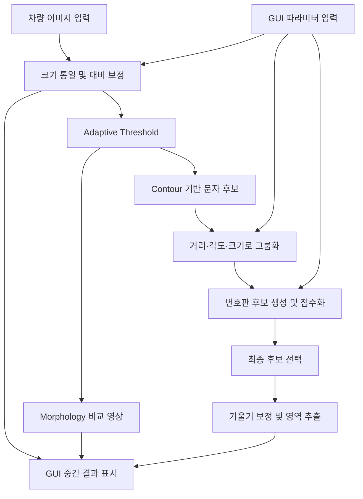
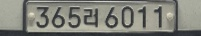

# OpenCV | 차량 번호판 검출 및 파라미터 실험 GUI

[발표자료 PDF](docs/presentation/project-report.pdf) · [개발 과정과 실험 기록](docs/PROJECT_NOTES.md) · [설치 및 실행](#설치-및-실행)

차량 이미지에서 번호판 영역을 찾고, 기울기를 보정한 이미지를 추출하는 시스템프로그래밍 전공 수업의 개인 프로젝트입니다. 딥러닝 없이 **문자 후보의 크기·간격·정렬을 분석해 번호판 후보를 선택**하고, PySide6 GUI에서 파라미터와 중간 처리 결과를 비교하도록 구성했습니다.

## 프로젝트 한눈에 보기

| 항목 | 내용 |
| :--- | :--- |
| 과목·형태 | 시스템프로그래밍 기말 프로젝트, 개인 과제 |
| 작성자 | 김재윤 |
| 발표자료 표기일 | 2026-06-08 |
| 목표 | 번호판 영역 검출, 회전 보정 및 추출, GUI 기반 파라미터 실험 |
| 입력 | 차량 전면·후면 정지 이미지 |
| 출력 | 검출 영역, 번호판 추출 이미지, 후보 개수·점수·각도 |
| 환경 | Windows / Python 3.12.5 |
| 핵심 기술 | OpenCV 전처리, Contour 분석, 문자 그룹화, 후보 점수화, PySide6 |
| 구현 범위 | 번호판 영역 검출·추출. 문자 내용을 읽는 OCR은 미포함 |


발표 당시 이미지별로 파라미터를 조정한 실험 화면입니다. 현재 기본값을 고정한 실행 결과는 [현재 코드 실행 기록](#현재-코드-실행-기록)에 별도로 정리했습니다.

## 본인 담당 및 개발 과정

개인 과제로 번호판 검출 파이프라인과 GUI를 구성하고 이미지별 결과를 확인하며 파라미터를 조정했습니다. ChatGPT를 알고리즘 구조 검토, 코드 분리, 오류 분석, 발표자료 구성에 활용했으며 실행 결과를 확인하며 수정했습니다.

| 작업 | 구현 내용 |
| :--- | :--- |
| 영상처리 | 대비 보정·이진화, 문자 후보 필터링, 그룹화, 후보 점수화 |
| 영역 추출 | 문자 배열로 번호판 기울기를 추정하고 회전 보정 후 추출 |
| GUI 연결 | 이미지 열기·저장, 파라미터 슬라이더, 처리 단계 선택, 검출 정보 표시 |
| 입출력 개선 | 한글 경로를 지원하는 이미지 읽기·쓰기 |
| 실험과 정리 | 조명·각도·배경이 다른 이미지 비교, 발표자료 작성 |

## 시스템 구조



영상처리는 `plate_detector.py`, 화면 구성은 `plate_gui.py`, 이벤트와 결과 표시는 `main.py`가 담당합니다. `PlateParams`에서 검출 파라미터를 관리합니다.

## 핵심 설계 포인트

### 1. 조명 변화에 대응하는 전처리

너비를 960px로 통일한 뒤 Gray 변환, Top-hat·Black-hat, CLAHE, Gaussian Blur, Adaptive Threshold를 적용합니다. 문자와 배경의 대비를 조절하고 이진 영상에서 윤곽선을 찾습니다.


Morphology Close는 비교 화면을 위해 별도로 계산합니다. 현재 문자 후보 검출은 Adaptive Threshold 결과를 사용하므로 Morphology 커널 슬라이더는 후보 계산에 직접 반영되지 않습니다.

### 2. 문자 배열을 이용한 후보 선택

윤곽선의 면적·폭·높이·종횡비로 문자 후보를 고르고, 후보 간 거리·각도·크기·세로 위치 차이를 비교해 그룹화합니다. 각 그룹에서 번호판 후보를 만든 뒤 문자 개수, 정렬도, 간격, 종횡비, 위치, 기울기 등을 가중 합산해 순위를 정합니다.

점수는 직접 정한 휴리스틱의 가중 합이며, 정답일 확률이나 검출 정확도가 아닙니다.

### 3. 파라미터 조절과 결과 비교

GUI에서 이진화·면적·종횡비를 조절하고 Gray, CLAHE, Threshold, 문자 후보, 번호판 후보를 비교할 수 있습니다. 최종 영역을 회전 보정해 별도로 표시하고, 현재 선택한 결과 이미지를 JPG·PNG로 저장합니다.

한글 경로에는 `np.fromfile`과 `cv2.imdecode`를 사용합니다. 연속 슬라이더 입력은 단발성 QTimer로 마지막 입력 후 150ms에 재처리합니다. 영상처리는 GUI 스레드에서 실행합니다.

## 실험 자료

발표자료에는 주간, 저조도, 복잡한 배경, 기울어진 번호판을 대상으로 GUI에서 설정을 조정한 실험이 담겨 있습니다. 아래는 당시 기록이며 현재 기본값의 일괄 검출 성능과 구분합니다.

<details>
<summary><strong>GUI 구성과 조작 화면 보기</strong></summary>


</details>

<details>
<summary><strong>복잡한 배경·저조도·큰 기울기 실험 보기</strong></summary>


이미지별 슬라이더 설정이 다르며 큰 기울기에서의 실패 사례도 포함합니다. 당시 코드 버전과 모든 설정을 별도 실행 기록으로 확정하지는 않았습니다.

</details>

### 현재 코드 실행 기록

보관된 샘플 6장을 동일한 기본 파라미터로 처리했습니다. 05번은 번호판을 추출했고, 02번은 일부가 잘렸으며, 나머지는 다른 영역을 선택했습니다. 아래 관찰은 육안 비교이며 정답 영역을 이용한 정량 평가와 구분합니다.



<details>
<summary><strong>기본값 6장 전체 결과와 재생성 방법 보기</strong></summary>

| 입력 | 검출 결과 | 추출 이미지 | 관찰 내용 |
| :--- | :--- | :--- | :--- |
| [01.png](samples/01.png) | [보기](docs/images/01_detection.jpg) | [보기](docs/images/01_crop.jpg) | 오른쪽 배경 오검출 |
| [02.png](samples/02.png) | [보기](docs/images/02_detection.jpg) | [보기](docs/images/02_crop.jpg) | 번호판 일부 잘림 및 배경 포함 |
| [03.jpg](samples/03.jpg) | [보기](docs/images/03_detection.jpg) | [보기](docs/images/03_crop.jpg) | 배경 울타리 오검출 |
| [04.jpg](samples/04.jpg) | [보기](docs/images/04_detection.jpg) | [보기](docs/images/04_crop.jpg) | 저조도에서 배경 오검출 |
| [05.jpg](samples/05.jpg) | [보기](docs/images/05_detection.jpg) | [보기](docs/images/05_crop.jpg) | 번호판 영역 선택 및 추출 |
| [06.jpg](samples/06.jpg) | [보기](docs/images/06_detection.jpg) | [보기](docs/images/06_crop.jpg) | 번호판 위 그릴 오검출 |

[전체 비교 이미지](docs/images/overview.jpg) · [실행 결과 기록](docs/images/demo_results.json)

가상환경 설치 후 프로젝트 폴더에서 실행합니다.

```powershell
.\.venv\Scripts\python.exe scripts/generate_demo.py
```

</details>

## 설치 및 실행

Windows / Python 3.12.5에서 GUI 객체 생성과 샘플 6장 처리를 확인했습니다. 패키지 버전은 `requirements.txt`에 기록했습니다.

```powershell
git clone https://github.com/kjy-02/opencv-license-plate-detector.git
cd opencv-license-plate-detector
python -m venv .venv
.\.venv\Scripts\python.exe -m pip install -r requirements.txt
.\.venv\Scripts\python.exe main.py
```

1. `Open Image`로 `samples/`의 이미지 또는 사용자가 준비한 이미지를 선택합니다.
2. 검출 결과와 추출 이미지를 확인하고 슬라이더로 파라미터를 조절합니다.
3. `Result Mode`로 처리 단계를 비교하고 `Save Result`로 현재 결과를 저장합니다.

기본 이미지 선택 경로와 결과 저장 경로는 실행한 폴더의 `samples/`, `results/`입니다. `results/`는 Git 추적에서 제외합니다.

## 저장소 구성

```text
.
├── README.md                    # 프로젝트 소개와 실행법
├── main.py                      # GUI 이벤트 및 결과 표시
├── plate_gui.py                 # PySide6 화면 구성
├── plate_detector.py            # 검출 및 영역 추출
├── requirements.txt             # 실행 의존성
├── samples/                     # 입력 이미지 6장
├── scripts/generate_demo.py      # 현재 코드의 시연 결과 재생성
└── docs/
    ├── PROJECT_NOTES.md          # 개발 과정과 실험 설명
    ├── images/                  # 현재 코드의 검출·추출 결과
    └── presentation/            # 발표자료 PDF와 발췌 페이지
```

## 현재 구현의 범위

- 이미지별 수동 파라미터 조정이 필요하며, 기본값의 배경·그릴 오검출이 확인됐습니다.
- 발표자료의 10장 기준 성공률·오검출 개선 수치는 원본 기록으로 보존했습니다. 당시 평가 데이터 전체, 정답 영역, 비교 코드가 없어 현재 저장소의 재현된 성능으로 제시하지 않습니다.
- 정답 영역과 비교한 정확도 평가는 수행하지 않았습니다. `plate_found=True`는 점수 기준을 통과한 후보가 있다는 뜻입니다.
- 타이머는 연속 입력의 처리 요청을 줄이지만 처리 중 GUI 응답 지연은 남을 수 있습니다.
- `plate_gui.py`는 생성된 코드이며 원본 `plate_gui.ui`는 현재 자료에 포함되어 있지 않습니다.

후속 개선은 이미지별 파라미터 저장·불러오기, 후보 순위 개선, 정답 영역 기반 평가, GUI 처리 스레드 분리입니다.

## 원본 자료

- [전공 수업 발표자료 PDF](docs/presentation/project-report.pdf)
- [발표자료의 전체 처리 흐름](docs/presentation/page-05.png)
- [발표자료의 코드 구조 개선](docs/presentation/page-16.png)
- [개발 과정 및 실험 상세](docs/PROJECT_NOTES.md)
- [샘플 이미지 안내](samples/README.md)

발표자료와 이미지는 프로젝트 작성자가 이 저장소에서 재사용하도록 제공했습니다.
